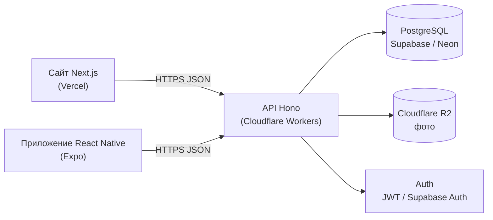
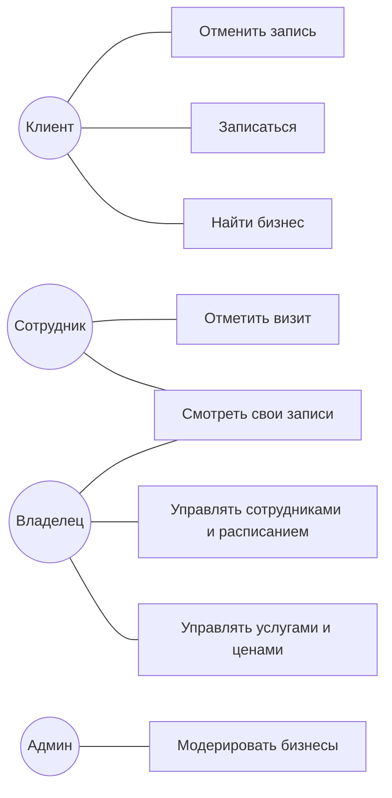
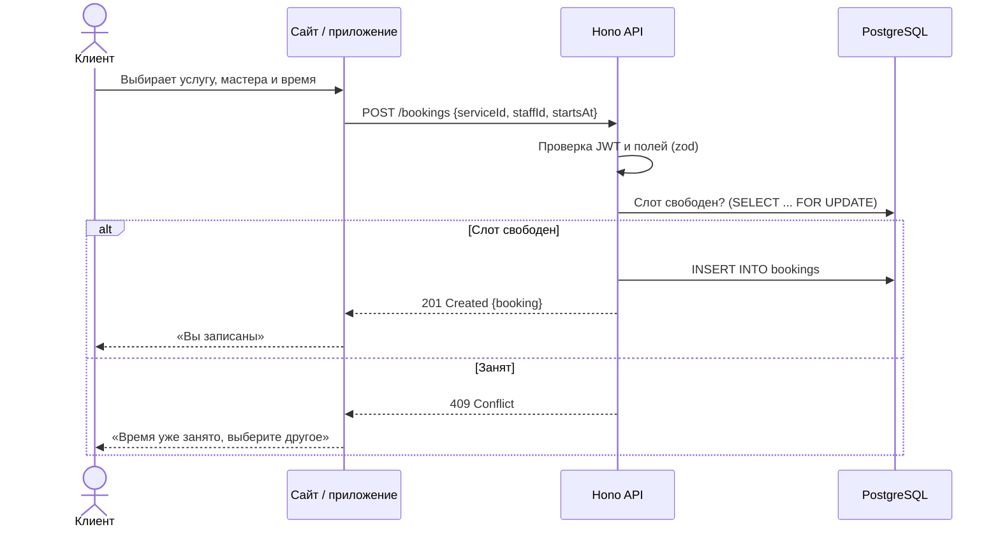

# План проекта: BatTap

Заполнено по [руководству](./Руководство%20по%20подготовке%20плана%20проекта.md).
Стек и порядок изучения: [Stack-Roadmap.md](./Stack-Roadmap.md).

---

## 1. Тема и краткое описание проекта

**Название:** BatTap — платформа онлайн-записи в местный бизнес (сайт + мобильное приложение).

**Описание.** BatTap собирает в одном месте местные сервисы: автосервисы, салоны красоты,
барбершопы, клиники и мастерские. Клиент находит бизнес, видит услуги, цены и свободное время
и записывается в два касания. Владелец бизнеса управляет услугами, ценами и расписанием
сотрудников через панель. Сотрудник видит только свои записи на день. Сейчас запись в
большинство таких мест идёт через звонки и мессенджеры, из-за чего теряются клиенты, бывают
накладки по времени и нет истории визитов. BatTap заменяет это одной системой с ролями,
которая работает в браузере, на Android и на iOS.

## 2. Цель и задачи проекта

**Цель:** запустить работающий MVP, в котором клиент может найти бизнес и записаться,
а владелец и сотрудник — управлять записями.

**Задачи:**

1. Спроектировать базу PostgreSQL с ролями (владелец, сотрудник, клиент, админ) и правами.
2. Разработать REST API на Hono + TypeScript и развернуть его на Cloudflare Workers.
3. Сделать сайт на Next.js (каталог, карточка бизнеса, запись, панель владельца) с деплоем на Vercel.
4. Сделать мобильное приложение на React Native (Expo) для клиентов и собрать apk.
5. Настроить Docker Compose, чтобы любой участник поднимал проект одной командой.

## 3. Проблема и актуальность

- **Проблема.** Записи ведутся вручную: звонки, WhatsApp, бумажный журнал. Клиент не видит
  свободное время, бизнес теряет заявки вне рабочих часов, сотрудники путают слоты.
- **Кого затрагивает.** Малый бизнес в сфере услуг и их клиентов; в Бишкеке это тысячи
  точек, большинство без собственной системы записи.
- **Польза.** Запись 24/7, меньше неявок (напоминания), прозрачное расписание, история клиентов.

| Аналог | Что делает хорошо | Чего не хватает |
| --- | --- | --- |
| 2ГИС | Каталог и карта | Нет полноценной записи с выбором мастера и времени |
| YCLIENTS / Fresha | Мощная запись и CRM | Дорого для малого бизнеса, нет локального каталога |
| Instagram + WhatsApp | Все уже пользуются | Нет расписания, всё вручную, легко потерять заявку |

## 4. Область применения и границы проекта

**Пользователи и роли:**

| Роль | Что может |
| --- | --- |
| Клиент | Искать бизнес, смотреть услуги, записываться, отменять свою запись |
| Сотрудник | Видеть свои записи, отмечать «пришёл / не пришёл» |
| Владелец | Управлять бизнесом, услугами, ценами, сотрудниками и расписанием |
| Администратор | Модерировать бизнесы и пользователей платформы |

**User Personas:**

- *Айбек, 28, клиент.* Хочет записаться на замену масла в субботу, не звоня. Важно: видеть цену и свободное время.
- *Нургуль, 35, владелица салона.* Хочет, чтобы мастера не пересекались по времени и чтобы клиенты не терялись ночью.
- *Эрлан, 24, мастер.* Хочет утром открыть телефон и увидеть список своих клиентов на день.

**Входит в MVP:** каталог и поиск, карточка бизнеса, запись на услугу и время, роли и
авторизация, панель владельца, список записей сотрудника, фото бизнесов, мобильное приложение для клиента.

**Не входит в MVP:** онлайн-оплата, программы лояльности, отзывы с модерацией, карта, iOS-публикация в App Store.

**Ограничения и предположения:** нужен интернет; Android 8+ и современные браузеры;
один часовой пояс (Asia/Bishkek); интерфейс на русском (кыргызский — в расширениях).

## 5. Методология и подход

- **Процесс:** итерации по 1 неделе (упрощённый Scrum), задачи в GitHub Projects.
- **Ветки:** работа только в ветках, Pull Request → preview-ссылка Vercel → слияние в `main`. Прямые пуши в `main` запрещены.
- **Этапы:** исследование → схема базы → API → сайт → мобильное приложение → тестирование → документация.
- **Тестирование:** unit-тесты API (Vitest), проверка маршрутов в Postman, включая неверные данные;
  ручное тестирование в Chrome DevTools в режиме Slow 4G; тест на реальном Android-телефоне.
- **Данные:** вводятся владельцами через панель; фото загружаются в Cloudflare R2;
  все входящие данные API проверяются схемами zod.

## 6. Технологии и инструменты

| Категория | Инструмент / Технология | Назначение |
| --- | --- | --- |
| Frontend | Next.js (React, TypeScript), Tailwind CSS | Сайт: каталог, запись, панель владельца |
| Mobile | React Native + Expo | Приложение клиента для Android и iOS из одного кода |
| Backend | Hono + TypeScript, zod | REST API, валидация запросов |
| Альтернативный backend | Laravel (PHP, Eloquent) | Если команде ближе PHP; нужен обычный сервер |
| База данных | PostgreSQL (Supabase или Neon) | Пользователи, роли, бизнесы, услуги, записи |
| Хранилище файлов | Cloudflare R2 | Фото бизнесов и услуг |
| Деплой API | Cloudflare Workers (`wrangler deploy`) | Дешёвый хостинг API по всему миру |
| Деплой сайта | Vercel | Автодеплой из GitHub, preview на каждую ветку |
| Локальная среда | Docker, Docker Compose | Одинаковая база и окружение у всей команды |
| Среда разработки / IDE | VS Code, Android Studio | Код; эмулятор Android и сборка apk |
| Система контроля версий | Git, GitHub | Ветки, Pull Request, ревью |
| Дизайн / Прототипирование | Figma, dbdiagram.io | Макеты экранов, схема базы |
| Отладка и тесты | Chrome DevTools, Postman, Vitest | Запросы, производительность, тесты |
| Эксперимент | Flutter (Dart) | Только сравнение с React Native, не основной стек |

## 7. Ожидаемый результат / Итоговый продукт

- Сайт `battap.app` (Next.js на Vercel) с каталогом, записью и панелью владельца.
- API `api.battap.app` (Hono на Cloudflare Workers) с документацией маршрутов.
- Android-приложение (apk) для клиентов.
- Репозиторий с `docker-compose.yml` и README, по которому проект запускается одной командой.
- **Демонстрация:** живой сайт, apk на телефоне, тестовые аккаунты для каждой роли, видео 3–5 минут.

## 8. Основные функции и архитектура системы

| Название функции | Описание | Назначение |
| --- | --- | --- |
| Регистрация и вход | По телефону или email (Supabase Auth / JWT) | Профиль и контроль доступа |
| Роли и права | users → user_roles → roles → role_permissions → permissions | Разграничение: владелец, сотрудник, клиент, админ |
| Каталог бизнесов | Список, поиск, фильтр по категории | Найти нужный сервис |
| Карточка бизнеса | Услуги, цены, фото, сотрудники, свободные слоты | Решение о записи |
| Запись | `POST /bookings` с проверкой свободного времени | Основная логика |
| Отмена / перенос | Клиент отменяет, владелец переносит | Гибкость расписания |
| Панель владельца | CRUD услуг, цен, сотрудников, рабочих часов | Управление бизнесом |
| Записи сотрудника | Список на день, отметка визита | Работа мастера |
| Загрузка фото | Файлы в R2, ссылки в базе | Наглядность карточки |
| Уведомления | Напоминание о записи (push через Expo) | Меньше неявок |
| Админ-модерация | Одобрение новых бизнесов, блокировка | Качество каталога |

**Архитектура:** клиент–сервер, многослойный API (routes → services → repositories → database).



### Use Case Diagram



### Class Diagram (схема базы)

```mermaid
erDiagram
  USERS ||--o{ USER_ROLES : has
  ROLES ||--o{ USER_ROLES : assigned
  ROLES ||--o{ ROLE_PERMISSIONS : grants
  PERMISSIONS ||--o{ ROLE_PERMISSIONS : included
  BUSINESSES ||--o{ SERVICES : offers
  BUSINESSES ||--o{ STAFF : employs
  USERS ||--o{ STAFF : works_as
  USERS ||--o{ BOOKINGS : makes
  SERVICES ||--o{ BOOKINGS : for
  STAFF ||--o{ BOOKINGS : serves

  USERS { uuid id PK; text phone; text email; text name; timestamptz created_at }
  ROLES { int id PK; text code "owner|staff|client|admin" }
  PERMISSIONS { int id PK; text code "services.edit, bookings.read_own ..." }
  USER_ROLES { uuid user_id FK; int role_id FK; uuid business_id FK "null = глобальная роль" }
  ROLE_PERMISSIONS { int role_id FK; int permission_id FK }
  BUSINESSES { uuid id PK; text slug; text name; text category; text address; uuid owner_id FK }
  SERVICES { uuid id PK; uuid business_id FK; text name; int price; int duration_min }
  STAFF { uuid id PK; uuid business_id FK; uuid user_id FK; jsonb work_hours }
  BOOKINGS { uuid id PK; uuid client_id FK; uuid service_id FK; uuid staff_id FK; timestamptz starts_at; text status }
```

> Роль не хранится строкой в `users.role`: у человека может быть несколько ролей
> (например, владелец одного бизнеса и клиент другого), а права настраиваются отдельно.

### Sequence Diagram: запись на услугу



### Основные маршруты API

| Метод | Маршрут | Доступ |
| --- | --- | --- |
| GET | `/businesses?category=&q=` | Все |
| GET | `/businesses/:slug` | Все |
| GET | `/businesses/:slug/slots?date=` | Все |
| POST | `/bookings` | Клиент |
| PATCH | `/bookings/:id` (отмена, перенос, статус) | Клиент (своя), сотрудник, владелец |
| GET | `/me/bookings` | Клиент, сотрудник |
| POST/PATCH/DELETE | `/businesses/:id/services` | Владелец |
| POST/PATCH/DELETE | `/businesses/:id/staff` | Владелец |
| POST | `/uploads` (фото в R2) | Владелец |
| PATCH | `/admin/businesses/:id` | Админ |

### Структура репозитория

```
battap/
├── apps/
│   ├── api/        # Hono + TypeScript, Cloudflare Workers (wrangler.toml)
│   ├── web/        # Next.js, деплой на Vercel
│   └── mobile/     # React Native + Expo
├── packages/
│   └── shared/     # общие типы и zod-схемы для api, web и mobile
├── db/
│   ├── migrations/ # SQL-миграции, никаких таблиц «руками»
│   └── seed.sql    # тестовые бизнесы и аккаунты
├── docker-compose.yml
├── .env.example    # без настоящих паролей; .env в .gitignore
└── README.md
```

## 9. План-график (таймлайн)

| Этап | Описание | Срок |
| --- | --- | --- |
| 1. Анализ и исследование | Аналоги, интервью с 3–5 бизнесами, список требований | Неделя 1–2 |
| 2. Проектирование | Схема базы в dbdiagram.io, макеты в Figma, список маршрутов API | Неделя 3 |
| 3. База и Docker | Миграции PostgreSQL, роли и права, `docker-compose.yml`, seed-данные | Неделя 4 |
| 4. API | Hono: бизнесы, услуги, слоты, записи, авторизация, zod, деплой на Workers, R2 | Неделя 5–6 |
| 5. Сайт | Next.js: каталог, карточка, запись, панель владельца; Vercel + preview | Неделя 7–8 |
| 6. Мобильное приложение | Expo: список, карточка, запись, мои записи; apk через Android Studio | Неделя 9–10 |
| 7. Тестирование | Vitest, Postman, DevTools (Slow 4G), реальный телефон, исправление ошибок | Неделя 11 |
| 8. Документирование | README, описание API, отчёт, презентация, видео | Неделя 12 |

## 10. Интерфейс и UX-концепция

**Экраны клиента:** Главная (поиск + категории) → Список бизнесов → Карточка бизнеса
(фото, услуги, цены) → Выбор мастера и времени → Подтверждение → Мои записи.

**Экраны владельца (сайт):** Дашборд (записи на сегодня) → Услуги → Сотрудники и часы работы → Профиль бизнеса и фото.

**Экраны сотрудника:** Записи на день → Карточка записи (пришёл / не пришёл).

**Правила UX:**

- Запись не больше чем в 3 шага от карточки бизнеса.
- Свободные слоты показываются сразу, занятые не кликаются.
- Понятные ошибки: «Это время уже занято», а не «Error 409».
- Сайт проверяется на ширине телефона и в режиме Slow 4G.

## 11. Что будет представлено на защите

- Живой сайт и API по ссылкам, apk на телефоне.
- Тестовые аккаунты: клиент, сотрудник, владелец, админ.
- Сценарий демонстрации: клиент записывается → сотрудник видит запись → владелец меняет цену → клиент видит новую цену.
- Видео 3–5 минут на случай проблем с интернетом.

## 12. Риски и способы их снижения

| Риск | Вероятность | Что делаем |
| --- | --- | --- |
| Команда распыляется на Laravel и Hono, Flutter и React Native | Высокая | Один бэкенд (Hono) и одно приложение (React Native); остальное — эксперименты одного человека |
| Двойная запись на одно время | Средняя | Транзакция и проверка слота в API, уникальный индекс на (staff_id, starts_at) |
| Утечка паролей базы в GitHub | Средняя | Секреты только в `.env` и настройках Vercel / Cloudflare; `.env` в `.gitignore` |
| Чужие записи доступны из браузера | Средняя | Проверка прав в API; при прямом доступе к Supabase — Row Level Security на bookings |
| Эмулятор Android тормозит на слабом ноутбуке | Высокая | Тестировать на реальном телефоне через Expo Go |
| Ограничения D1 | Средняя | Основная база — PostgreSQL; D1 только для мелочей |

## 13. Возможные улучшения и расширения

- Онлайн-оплата и предоплата за запись.
- Отзывы и рейтинг бизнесов.
- Карта с бизнесами рядом.
- Telegram-бот для записи и напоминаний.
- Кыргызский язык интерфейса.
- Аналитика для владельца: загрузка мастеров, популярные услуги, выручка.
- Публикация в App Store и Google Play.

## 14. Источники и литература

- [Hono — документация](https://hono.dev/)
- [Cloudflare Workers, R2, D1](https://developers.cloudflare.com/)
- [Next.js — документация](https://nextjs.org/docs)
- [Vercel — документация](https://vercel.com/docs)
- [React Native](https://reactnative.dev/) и [Expo](https://docs.expo.dev/)
- [PostgreSQL — документация](https://www.postgresql.org/docs/)
- [Supabase](https://supabase.com/docs) и [Neon](https://neon.tech/docs)
- [Docker — Get Started](https://docs.docker.com/get-started/)
- [zod](https://zod.dev/)
- [Laravel](https://laravel.com/docs) и [Flutter](https://docs.flutter.dev/) — альтернативы
- [Chrome DevTools — Network](https://developer.chrome.com/docs/devtools/network)
- [MDN Web Docs](https://developer.mozilla.org/)

## 15. Приложения

- Похожие проекты: YCLIENTS, Fresha, Booksy, 2ГИС.
- Схема базы: dbdiagram.io (ссылка после этапа 2).
- Макеты: Figma (ссылка после этапа 2).
- Репозиторий: этот GitHub-репозиторий; задачи — GitHub Projects.
- Стек и практика: [Stack-Roadmap.md](./Stack-Roadmap.md).
